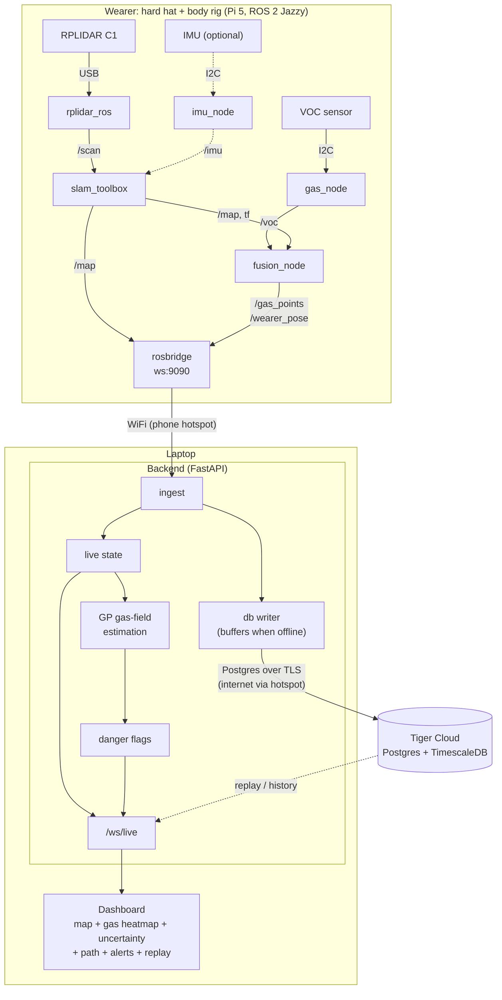

# Firefighter Hazard-Mapping System

Wearable indoor SLAM + gas sensing that builds a live map of airborne hazards in an unknown building as a firefighter moves through it.

---

## 1. The Idea

**Problem.** Gas exposure (VOCs, CO, HCN, etc.) is a well-documented and under-instrumented danger in structural firefighting. Firefighters enter unknown buildings with no spatial picture of where hazardous concentrations are, and incident command has no live view of it either.

**Solution.** A body-worn rig that:

1. Runs 2D LiDAR SLAM to localize the wearer and build a floor map of the unknown building in real time.
2. Samples VOC concentration continuously from a wearable gas sensor.
3. Fuses the two: every gas reading is stamped with the wearer's current map position.
4. Streams to a unified dashboard that renders the map, the gas concentration field, the wearer's path, and flags dangerous zones.
5. Stores every run in **Tiger Cloud** (Postgres + TimescaleDB) so walks can be replayed, compared over time, and reviewed after the incident.

**What's novel.** Indoor SLAM and wearable gas sensing are each well studied, and gas safety in firefighting is a validated problem. We haven't found prior work that integrates the two into a live, spatially-registered hazard map on a wearable platform.

**Stretch features.**
- Bayesian / Gaussian Process estimation of the gas field (concentration + uncertainty) from sparse samples
- Temporal tracking of gas movement (plume drift between scans), via TimescaleDB `time_bucket` / continuous aggregates over stored samples
- Threshold-based danger flags on the map
- Post-incident replay and history from the database
- Multi-wearer merging (future). Every row already carries `wearer_id`.

---

## 2. Hardware

### Confirmed / in hand

| Component | Spec / Notes | Owner |
|---|---|---|
| Raspberry Pi 5 | Main compute. Runs OS, ROS 2, SLAM, sensor drivers, fusion. | Tyler |
| Slamtec RPLIDAR C1 | 2D planar LiDAR, 360°, 12 m range, 10 Hz. 5 V, ~230 mA typ / ~300 mA peak. USB via serial adapter. | Tyler (shipment) |
| VOC sensor | SGP30/40 or BME680/688 class, I2C. | Tyler (shipment) |
| USB-C PD power bank | 3 A minimum. Pi 5 caps USB output at 600 mA on a 3 A supply; C1 at 230 mA fits comfortably. | — |
| MicroSD card | 32–64 GB, A2 / V30 rated. | Justin (Best Buy) |
| USB-C SD card reader | For flashing from Mac. | Justin (Best Buy) |
| 3D printer | For mounts. | Justin |
| Hard hat (Waterloo Eng, yellow) | Demo helmet. LiDAR mount hot-glued on, removable after. | Justin |
| Straps / velcro | For body rig. | Tyler |

### Nice-to-have

| Component | Why |
|---|---|
| IMU (MPU6050 / BNO055 / ICM-20948) | No wheel odometry on a person; IMU makes SLAM noticeably more stable. Tyler does not have one — check MLH hardware table. |
| Short USB-C → USB-C cable (60 W+) | Pi to power bank, short so it doesn't flop. |
| Short USB-A → USB-C/micro cable | For the C1 adapter board if the kit didn't include one. |
| Jumper wires (F-F) | 4 wires for I2C sensor: 3V3, GND, SDA, SCL. MLH table likely has them. |
| Pi Camera | Live video feed on dashboard (demo polish). |
| Buzzer / LED | On-body danger alert. |
| Isopropyl alcohol / hand sanitizer / Sharpie | Instant VOC spike for live demo. |

### Power notes

- Pi 5 checks its supply on boot. 5 A supply → USB ports get 1.6 A total; 3 A or unnegotiated → capped at 600 mA.
- C1 draws ~230 mA typical, so a 3 A bank is fine.
- Fallback if anything's flaky: power the C1 from a second bank port instead of the Pi, or set `usb_max_current_enable=1` in `/boot/firmware/config.txt`.
- **Test Pi + C1 on the actual bank early.** Brownouts show up as random reboots or dropped scans and are miserable to debug late.

### Networking

- Pi and laptop on the same network via **phone hotspot** (venue WiFi often blocks device-to-device traffic).
- Ethernet cable is optional backup only; not needed for the demo.

---

## 3. 3D Printed Parts

Priority order. PLA, 0.2 mm layers, 3 walls, 20–30 % infill.

1. **LiDAR mount plate** (critical). Small plate that screws into the C1's base holes and hot-glues to the top of the hard hat. Must keep the scan plane **level** — 2D SLAM assumes a horizontal scan. Check hole spacing / screw size on the C1 dimensional drawing (Waveshare wiki) or measure with calipers. Leave cable exit clearance. Print a 15-min test piece of the hole pattern before the full plate.
2. **Pi 5 case / tray.** Use an existing Pi 5 case from Printables (don't design one). Board is 85 × 56 mm, holes 58 × 49 mm, M2.5. Needs airflow, USB + USB-C accessible, GPIO reachable.
3. **Gas sensor bracket.** Tiny vented clip holding the breakout board away from the Pi's heat and exposed to moving air. Zip-tie slot is enough.
4. **Cable clips / strap guides.** Low priority.

Alternative mount considered: shoulder mount (more stable, less cool). Helmet chosen for demo.

---

## 4. Software Stack

### On the Pi 5

| Layer | Choice | Notes |
|---|---|---|
| OS | Ubuntu 24.04 Server 64-bit | ROS 2 Jazzy has official binaries. Set WiFi + SSH in Raspberry Pi Imager at flash time. |
| Middleware | ROS 2 Jazzy | Pub/sub between all nodes. |
| LiDAR driver | `ros-jazzy-rplidar-ros` | Publishes `/scan`. |
| SLAM | `ros-jazzy-slam-toolbox` | Works without odometry. Publishes `/map` and pose via `tf2`. (Hector SLAM is the alternative.) |
| Gas sensor node | Custom Python (`rclpy`) + Adafruit CircuitPython lib for the sensor | Publishes `/voc`. |
| Fusion node | Custom Python (`rclpy`) | Subscribes to pose + `/voc`, publishes `/gas_points` as `{x, y, voc, t}`. ~50 lines. |
| IMU node (optional) | `ros-jazzy-imu-tools` or custom | Feeds odometry to SLAM. |
| Bridge | `ros-jazzy-rosbridge-suite` | Websocket JSON out to the laptop. Avoids installing ROS 2 on macOS. |
| Launch | One launch file that brings everything up | Write this early. One command on demo day. |

### On the laptop

| Layer | Choice | Notes |
|---|---|---|
| Backend | Python 3.12 FastAPI (asyncio) | Consumes the rosbridge websocket, holds live state in memory, runs estimation + alerts, pushes to the dashboard over `/ws/live`, and writes to Tiger Cloud in the background. |
| Database | **Tiger Cloud** (managed PostgreSQL + TimescaleDB), via `asyncpg` | Hypertables for `gas_samples` and `poses`, plus map snapshots, field estimates, and alerts. A continuous aggregate gives per-cell VOC stats per 10 s. Used for persistence, replay, and history. The live path never waits on it. Schema: [`db/schema.sql`](db/schema.sql). |
| Gas field estimation | scikit-learn `GaussianProcessRegressor` (or GPyTorch) | Interpolates a 2D concentration field with uncertainty from sparse points. Threshold the posterior → danger flags. Simpler fallback: per-cell mean, either in memory or from the `gas_cells_10s` continuous aggregate. |
| Frontend | React + Vite + HTML canvas | Occupancy grid + gas heatmap overlay (uncertainty as alpha) + path + current pose + alerts + replay timeline. Talks only to the backend. |
| Debug viewer | Foxglove Studio | Talks to rosbridge, runs on Mac. Free live view of raw ROS data on day one. |

The Pi never talks to the database. Only the laptop backend holds the Tiger Cloud credentials, in `backend/.env`, which is gitignored.

### Dev tooling

- Git repo: `pi/` (ROS 2 workspace), `backend/`, `dashboard/`, `db/` (schema), `docs/`.
- VS Code Remote-SSH into the Pi.
- Tiger Cloud: one service on the Free plan. Apply the schema with `psql "$DATABASE_URL" -f db/schema.sql`. Local fallback: the same schema on `timescale/timescaledb` in Docker.
- A fake Pi publisher (`backend/tools/fake_pi.py`) emits the interface contract so backend + dashboard work can start before the hardware arrives.
- `ros2 bag record` one good walk **and** save it as a session in Tiger Cloud. Either one can be replayed so dashboard dev can continue without hardware, and either is the fallback demo if the live run hiccups.

---

## 5. Architecture

Full design (components, message formats, REST API, data model, failure modes, build order): **[docs/ARCHITECTURE.md](docs/ARCHITECTURE.md)**.



Solid arrows are the live path, which never waits on the database. Dashed arrows are optional or after-the-fact paths. Tiger Cloud tables: `sessions`, `gas_samples` and `poses` (hypertables), `map_snapshots`, `field_estimates`, `alerts`, and the `gas_cells_10s` continuous aggregate.

**Interface contract** (agree on this first). This is unchanged: the Pi doesn't know about the database.

```json
{ "t": 1729100000.123, "x": 3.21, "y": -1.04, "voc": 412.0 }
```

plus periodic `/map` occupancy grid updates (width, height, resolution, origin, int8 data) and `/wearer_pose` (~5 Hz, `map` frame). The backend adds `session_id` and `wearer_id` before storing anything.

**Data rules.** Coordinates are metres in each session's SLAM `map` frame, not lat/lon. The VOC unit depends on the sensor (SGP40 index / SGP30 ppb / BME68x Ω), so each session records `voc_unit` and `voc_threshold`.

---

## 6. Team Split

| Person | Owns |
|---|---|
| Tyler | Pi bring-up, ROS 2, LiDAR + sensor drivers, SLAM, fusion node, launch file |
| Justin | 3D printed mounts + physical rig, then backend + gas field estimation + Tiger Cloud schema / db writer |
| Richard | Dashboard frontend, rosbridge integration, Foxglove debugging, replay/history views (Tiger Cloud queries) |

(Adjust as needed — the only hard boundary is the JSON interface above.)

---

## 7. Demo Plan

1. Wearer puts on hard hat + rig, powers Pi from bank, one launch command.
2. Dashboard on projector shows an empty map and the wearer's pose.
3. Wearer walks the room; map fills in live, path traces behind them.
4. Wave an open bottle of isopropyl near the sensor → VOC spikes → red hotspot appears on the map at that location → alert fires.
5. Walk away; show the field estimate and uncertainty shading persisting.
6. End the session and scrub the timeline: replay the walk from Tiger Cloud and show the hotspot appear and fade over time (plume tracking).
7. Backup: replay a recorded `ros2 bag` or a stored Tiger Cloud rehearsal session if live hardware misbehaves.

---

## 8. Risks & Mitigations

| Risk | Mitigation |
|---|---|
| Pi power brownouts | Test on the real bank early; separate C1 power or `usb_max_current_enable=1` |
| Venue WiFi blocks P2P | Phone hotspot, not venue WiFi |
| SLAM drift from head movement | Keep mount level; add IMU if available; shoulder mount as fallback |
| ROS 2 install pain on Mac | rosbridge → websocket, no ROS on laptops |
| Live demo fails | Pre-recorded bag replay, or replay a rehearsal session from Tiger Cloud |
| Sensor heat drift | Mount sensor away from the Pi, in open air |
| Hotspot has no internet → Tiger Cloud unreachable | Live path doesn't depend on the DB. The db writer buffers and flushes when the connection returns. For a long outage, point `DATABASE_URL` at local Docker TimescaleDB (same schema). |
| DB credentials leak | Kept only in `backend/.env` (gitignored). Never on the Pi or in the frontend. |
| Free-plan storage (750 MiB) | Plenty for a few MB per walk. Delete old rehearsal sessions if needed (cascades). |

---

## 9. Logistics

- Arrive ~7:30, leave ~7:00.
- LiDAR + VOC sensor shipment arrives ~6 PM.
- Justin bringing: 3D printer, hard hat, microSD + reader, VR headset (Meta Quest).
- Tyler bringing: Pi 5, LiDAR, VOC sensor, straps/velcro, misc hardware.
