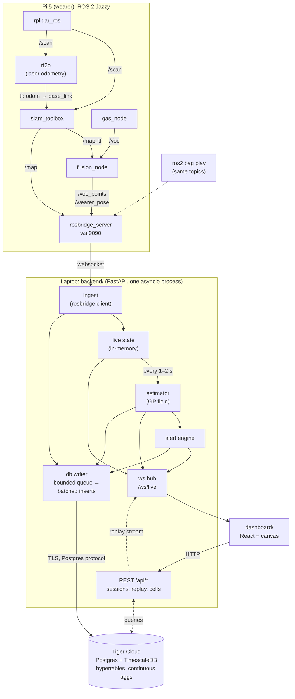

> **Superseded (Oct 17):** the backend was built to `backend-architecture (2).md` + `CLAUDE.md` (foxglove_bridge, `readings`/`voc_cells` schema, `/heatmap` endpoints, FastAPI on a Vultr VM rather than a laptop, Tiger Cloud as the database). This file is kept for the design rules and rationale; where they disagree, the newer docs win.

# Software Architecture

How data moves from the sensors on the helmet to the dashboard and into Tiger Cloud, the managed PostgreSQL + TimescaleDB service from Tiger Data. For the hardware, the team split, and the demo plan, see the [project README](../README.md).

---

## 1. Design rules

1. **The live path never waits on the database.** Pi → backend → dashboard must keep working with no internet. Tiger Cloud is on a side path that writes in the background (write-behind).
2. **One contract between the Pi and the laptop.** The Pi publishes ROS topics over rosbridge and knows nothing about the database. Only the backend holds DB credentials.
3. **Everything is a session.** One walk = one `session_id`. Live runs, bag replays, and DB replays all produce the same messages to the dashboard.
4. **Replay is a first-class source.** The dashboard can't tell live data from replayed data. This lets frontend work go on without hardware, and it is the backup demo.

---

## 2. System overview



Solid arrows are the live path. Dashed arrows are replay, history, and bag playback.

Three data paths:

| Path | Route | Latency target | Fails if… |
|---|---|---|---|
| **Live** | Pi → rosbridge → ingest → live state → ws hub → dashboard | < 500 ms | hotspot drops Pi ↔ laptop |
| **Persist** | ingest / estimator / alerts → db writer → Tiger Cloud | seconds (batched) | no internet. Rows wait in the queue, nothing else is affected |
| **Replay / history** | dashboard → REST → Tiger Cloud → ws hub (same messages as live) | ~1 s to start | no internet. Use `ros2 bag play` instead |

---

## 3. Components

### 3.1 Pi (`pi/`, ROS 2 Jazzy). Owner: Tyler

Same as the README, with one addition. Message formats for every topic are in [ros-messages.md](ros-messages.md).

- **`fusion_node`** also publishes **`/wearer_pose`** (`geometry_msgs/PoseStamped`, `map` frame, ~5 Hz) by looking up the `map → base_link` transform. Without it the backend would have to subscribe to `/tf` through rosbridge, which is noisy and awkward. With it, the dashboard can draw the path faster than the gas sample rate.

| Topic | Type | Rate | Consumer |
|---|---|---|---|
| `/voc_points` | `sensor_msgs/PointCloud2` (`x, y, z, voc`, see contract) | ~1 Hz (sensor rate) | backend, RViz/Foxglove |
| `/wearer_pose` | `geometry_msgs/PoseStamped` | ~5 Hz | backend |
| `/map` | `nav_msgs/OccupancyGrid` | slam_toolbox default (a few s) | backend |

Throttle `/map` at the rosbridge side (`throttle_rate` on subscribe) so the full grid isn't re-sent as JSON too often.

### 3.2 Backend (`backend/`, Python 3.12, FastAPI, asyncio). Owner: Justin

One process with five modules. They communicate through in-process `asyncio.Queue`s, not a message broker.

| Module | Responsibility |
|---|---|
| `ingest` | Websocket client to rosbridge (`roslibpy` or plain `websockets`). Subscribes to the three topics, stamps `session_id` + `wearer_id`, and pushes into live state and the db writer. Reconnects with backoff. |
| `state` | In-memory source of truth for the current session: latest map, current pose, last ~N gas points, latest field estimate, active alerts. |
| `estimator` | Every 1–2 s, fits the gas field on the current map grid and outputs mean + std (see §6). Runs in a thread pool so it never blocks the event loop. |
| `alerts` | Two triggers: (a) a raw sample is over `voc_threshold`, sent at once; (b) a field cell has `P(voc > threshold) > 0.5`, sent after each estimate. Debounced per cell. |
| `db_writer` | Bounded queue (e.g. 50k rows). Flushes every 500 ms or 200 rows with `asyncpg` `copy_records_to_table` / `executemany`. On error: exponential backoff and keep buffering. If the queue fills, drop the oldest rows first and log a counter. Never blocks `ingest`. |
| `api` | `/ws/live` websocket hub plus the REST routes below. Serves the built dashboard as static files. |

Config comes from `backend/.env` (gitignored):

```
DATABASE_URL=postgres://tsdbadmin:<password>@<host>:<port>/tsdb?sslmode=require
ROSBRIDGE_URL=ws://<pi-hostname>.local:9090
VOC_UNIT=voc_index
VOC_THRESHOLD=250
```

### 3.3 Tiger Cloud (`db/`). Owner: Justin (schema), Richard (history queries)

- One Tiger Cloud service. The Free plan (two services, 750 MiB storage each) is enough for this project (§5.3).
- The schema lives in [`db/schema.sql`](../db/schema.sql). Apply it with `psql "$DATABASE_URL" -f db/schema.sql`.
- The same schema runs on local `timescale/timescaledb` in Docker as the offline fallback (§7).

### 3.4 Dashboard (`dashboard/`, React + Vite + HTML canvas). Owner: Richard

A single page with stacked canvas layers, drawn bottom to top:

1. Occupancy grid (unknown = dark gray, free = light, occupied = black)
2. Gas heatmap: color = field mean, alpha = `1 − normalized std`, so cells with no data fade out
3. Danger cells outlined in red
4. Path polyline and current pose arrow
5. Alert banner and alert list, which you can click to pan to the alert location

Controls: start/stop session, live/replay toggle, and a timeline scrubber for replay. The dashboard talks only to the backend, never to rosbridge or the database directly. Foxglove stays as the raw-ROS debug view.

---

## 4. Interfaces

### 4.1 Pi → backend (the hard boundary)

`/voc_points`: `sensor_msgs/PointCloud2` in the `map` frame. Each point is `x, y, z, voc` as float32 plus `t` (reading time, unix seconds) as float64: 24 bytes. Full layout: [ros-messages.md](ros-messages.md#voc_points-sensor_msgspointcloud2-the-contract).

How `ingest` reads it:
- rosbridge sends `data` as a base64 string. Decode it with numpy (`np.frombuffer(b64decode(data), dtype="<f4").reshape(-1, 4)`). There's no ROS on the laptop, so `sensor_msgs_py` isn't available.
- **New points only:** a point is new iff its `t` is later than the newest `t` already processed. This works whether each message carries just the newest reading, everything so far, or a full ring buffer, and it keeps repeated identical readings (standing still). Switching session keeps this watermark, so the old session's points aren't re-filed under the new one.
- **Time:** each row gets its point's `t` (Pi clock, NTP-synced over the hotspot). Clouds without `t` fall back to the message's `header.stamp` and a length/content guess.

`x`, `y` are metres in the `map` frame. The backend adds `session_id` and `wearer_id`, so the Pi doesn't need to know about sessions.

If the cloud re-sends every point, messages grow over the walk (~24 bytes per reading, so ~10 KB after 10 minutes at 1 Hz, before base64). That's fine for a demo. If it ever gets heavy, have the Pi publish only new points. The backend needs no change.

### 4.2 Backend → dashboard: `/ws/live`

Every message is `{ "type": ..., "session_id": ..., "t": ..., ... }`:

| `type` | Payload | When |
|---|---|---|
| `session` | `{ name, voc_unit, voc_threshold, source: "live" \| "replay" }` | on connect and when the session changes |
| `map` | `{ width, height, resolution, origin: [x, y], data: <base64 int8> }` | when the map changes |
| `pose` | `{ x, y, theta }` | ~5 Hz |
| `sample` | `{ x, y, voc }` | each gas point |
| `field` | `{ width, height, resolution, origin, mean: <base64 f32>, std: <base64 f32> }` | every 1–2 s |
| `alert` | `{ id, kind, x, y, value }` | when triggered |

Binary grids are sent as base64 so the protocol stays plain JSON. The dashboard decodes them into `Int8Array` / `Float32Array`.

### 4.3 REST (`/api`)

| Route | Purpose |
|---|---|
| `POST /api/sessions` `{name, voc_threshold}` | Start a session. Ingest begins tagging data with the new id. |
| `POST /api/sessions/{id}/end` | Stop a session (sets `ended_at`). |
| `GET /api/sessions` | List past sessions. |
| `POST /api/sessions/{id}/replay` `{speed, from?}` | Stream a stored session over `/ws/live` with the same message types. |
| `GET /api/sessions/{id}/cells?bucket=10s&from&to` | Per-cell stats from the `gas_cells_10s` continuous aggregate, for the fallback heatmap and plume drift. |
| `GET /api/sessions/{id}/alerts` | Alert history. |
| `POST /api/alerts/{id}/ack` | Acknowledge an alert. |

---

## 5. Data model (Tiger Cloud)

### 5.1 Tables

| Table | Kind | Rows | Notes |
|---|---|---|---|
| `sessions` | regular | 1 per walk | Holds `voc_unit` and `voc_threshold`, because the VOC scale depends on the sensor (SGP40 index, SGP30 ppb, BME68x Ω) |
| `gas_samples` | **hypertable** on `time` | ~1/s | Raw fused readings. The ground truth everything else is computed from. |
| `poses` | **hypertable** on `time` | ~5/s | Wearer path |
| `map_snapshots` | regular, PK `(session_id, time)` | ~1/5 s, only when changed | zlib-compressed int8 grid |
| `field_estimates` | regular, PK `(session_id, time)` | ~1/10 s | zlib-compressed float32 mean + std, plus model params |
| `alerts` | regular | sparse | Includes `acked_at` |
| `gas_cells_10s` | **continuous aggregate** | — | `time_bucket('10 s')` × 0.25 m cell → avg, max, count |

### 5.2 Why TimescaleDB features matter here

- **Hypertables**: samples and poses are append-only time series. Every replay and history query filters on `(session_id, time range)`.
- **Continuous aggregate `gas_cells_10s`**: provides the per-cell fallback estimator, the replay heatmap, and temporal plume tracking (compare the same cells across buckets) without any backend code. It is created with `materialized_only = false`, so the newest rows that are not materialized yet are still included.
- **`time_bucket`**: ad-hoc questions during and after a run, e.g. "max VOC per 30 s in this room".

Example query: per-cell peak VOC over the last 2 minutes of a session:

```sql
SELECT cell_x, cell_y, max(voc_max) AS peak, sum(n) AS samples
FROM gas_cells_10s
WHERE session_id = $1 AND bucket > now() - INTERVAL '2 minutes'
GROUP BY cell_x, cell_y;
```

### 5.3 Size budget

A 10-minute walk is about 600 gas rows + 3,000 pose rows (well under 1 MB), ~120 map snapshots (a compressed 400×400 grid is tens of KB each), and ~60 field estimates. That is a few MB to a few tens of MB per session, so the Free plan's 750 MiB holds many rehearsal runs. If it fills up, delete old rehearsal sessions (`ON DELETE CASCADE` removes their rows).

---

## 6. Gas field estimation

Owner: Justin

- **Model**: scikit-learn `GaussianProcessRegressor` with `ConstantKernel * RBF(length_scale≈1.5 m) + WhiteKernel`, fit on `(x, y) → voc`.
- **Point budget**: exact GP fitting is O(n³). Cap the training set at ~500 points: keep the most recent ones, and thin older ones to one per 0.25 m cell. This also gives some temporal decay, so the estimate follows plume movement.
- **Prediction grid**: the occupancy map grid downsampled to 0.25 m, predicted only on free/known cells.
- **Danger**: `P(voc > T) = 1 − Φ((T − mean) / std)`. A cell counts as dangerous when this is > 0.5. Its uncertainty also feeds the heatmap alpha.
- **Fallback** (if the GP is too slow or unstable): the per-cell running mean from `gas_cells_10s`, or the same in-memory calculation when offline. The dashboard renders both through the same `field` message.
- **Re-fit hyperparameters** only every ~10 fits. In between, reuse the kernel with `optimizer=None` to keep each fit under ~200 ms on the laptop.

---

## 7. Failure modes

| Failure | What happens | Mitigation |
|---|---|---|
| Hotspot has no internet | Live demo unaffected. `db_writer` buffers and logs "DB offline (N queued)". | Rows flush once the connection returns. For a long outage, point `DATABASE_URL` at local Docker TimescaleDB, which uses the same schema. |
| Pi ↔ laptop link drops | Dashboard shows "wearer disconnected" plus the last known pose. | `ingest` reconnects with backoff. Data is lost for the gap (acceptable). |
| Estimator too slow | Field updates lag. | Lower the point cap, increase the interval, or switch to the per-cell fallback. |
| Tiger Cloud credentials leak | — | Credentials live only in `backend/.env` (gitignored), never on the Pi and never in the frontend bundle. |
| Live hardware fails at demo | — | `ros2 bag play` through rosbridge, or `POST /api/sessions/{id}/replay` of a rehearsal run from Tiger Cloud. |
| Pi clock wrong | Timestamps skewed. | Pi syncs NTP over the hotspot. The backend logs a warning if `t` differs from its own clock by more than 2 s. |

---

## 8. Repo layout

```
pi/                       ROS 2 workspace (colcon)
  src/hazard_nodes/       gas_node, fusion_node, launch/bringup.launch.py
backend/
  app/{ingest,state,estimator,alerts,db_writer,api}.py
  .env.example
  pyproject.toml
dashboard/                React + Vite
db/
  schema.sql
docs/
  ARCHITECTURE.md
bags/                     recorded ros2 bags (gitignored, or Git LFS)
```

---

## 9. Build order

1. **Contract first**: agree on the `/voc_points` layout and the `/ws/live` message types (§4). Commit a fake publisher (`backend/tools/fake_pi.py`) that emits a random walk plus a VOC blob, so the backend and dashboard can be built before the hardware arrives.
2. **Tiger Cloud**: create the service, apply `db/schema.sql`, and put the connection string in `.env`.
3. **Thin vertical slice**: fake Pi → ingest → `/ws/live` → dashboard dots on a blank canvas, plus rows appearing in `gas_samples`.
4. **Real Pi**: swap the fake publisher for rosbridge. Add the map layer and the path.
5. **Estimator + alerts**: start with the per-cell fallback, then the GP.
6. **Replay from Tiger Cloud** and the timeline scrubber.
7. **Rehearse**: record a bag *and* a DB session of one good walk. Both are backups.
