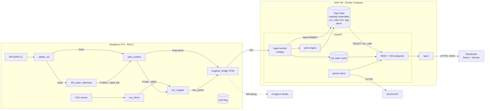

# Backend Architecture

Wearable LiDAR + VOC sensor → live floor plan with a gas heat map and the wearer's position.
The Pi is the only machine running ROS 2. Everything downstream is WebSocket / HTTP / SQL.

```
┌──────────────────────── Raspberry Pi 5 · Ubuntu 24.04 · ROS 2 Jazzy ────────────────────────┐
│                                                                                              │
│  RPLIDAR C1 ──USB──▶ rplidar_ros ──/scan──┬──▶ rf2o_laser_odometry ──tf odom→base_link──┐    │
│                                           │                                             ▼    │
│                                           └──────────────────────────────▶ slam_toolbox      │
│                                                                              │  /map         │
│                                                                              │  /pose        │
│  VOC (SGP40 / BME680) ──I²C──▶ voc_driver ──/voc──▶ voc_mapper ──/voc_points │  tf map→odom  │
│                                               (tf lookup map→base_link       │               │
│                                                at t − sensor_lag)            │               │
│                                                                              ▼               │
│  static_transform_publisher ──/tf_static──▶ base_link→laser, base_link→voc_link              │
│                                                                                              │
│  ros2 bag record /scan /tf /tf_static /voc        (always on: demo replay fallback)          │
│                                                                                              │
│                         ┌──────────────────────────────────┐                                 │
│   all topics ──DDS──▶   │  foxglove_bridge   ws://pi:8765  │  ◀── only exit from the Pi      │
│                         └────────────────┬─────────────────┘                                 │
└──────────────────────────────────────────┼───────────────────────────────────────────────────┘
                                           │ Wi‑Fi · WebSocket
                   ┌───────────────────────┼─────────────────────────┐
                   │                       │                         │
                   ▼                       ▼                         ▼
          Foxglove Studio          FastAPI ingest              (dashboard never
          (Mac, debug only)        (see below)                  talks to the bridge)


┌──────────────────────────────── Vultr VM · Ubuntu · Docker Compose ──────────────────────────┐
│                                                                                              │
│  ┌─────────────────────────── FastAPI (uvicorn) ───────────────────────────┐                 │
│  │                                                                         │                 │
│  │  ingest worker (asyncio task)                                           │                 │
│  │    roslibpy ──▶ subscribe /pose @10Hz, /voc_points, /map                │                 │
│  │    ├──▶ live state cache  {pose, voc, voc_window[60s], map_png, meta}   │                 │
│  │    ├──▶ batch buffer ──every 1 s──▶ INSERT INTO readings  ──────────────┼──┐              │
│  │    └──▶ alert engine  (threshold + hold time + cooldown)                │  │              │
│  │                                                                         │  │              │
│  │  API                                                                    │  │              │
│  │    WS   /ws/live       pose + voc @10Hz, map on change   ◀── cache      │  │              │
│  │    GET  /heatmap       decayed cell means + weights      ◀── voc_cells ─┼──┼──┐           │
│  │    GET  /trail         path with voc values              ◀── readings  ─┼──┼──┤           │
│  │    GET  /map           occupancy grid PNG + origin/res   ◀── cache      │  │  │           │
│  │    GET  /alerts        alert history                     ◀── alerts    ─┼──┼──┤           │
│  │    GET  /summary       Gemini walk report                ◀── voc_cells ─┼──┼──┤           │
│  │    GET  /sessions      list recorded sessions            ◀── readings  ─┼──┼──┤           │
│  │                                                                         │  │  │           │
│  │  gemini client  (google-genai)  ── top cells + heat PNG ──▶ report      │  │  │           │
│  └─────────────────────────────────────────────────────────────────────────┘  │  │           │
│                                                                                ▼  ▼           │
│  ┌──────────────────────── Tiger Data (TimescaleDB) ─────────────────────────────────────┐    │
│  │  hypertable      readings(ts, session, x, y, heading, voc)                            │    │
│  │  cont. aggregate voc_cells  = time_bucket(10 s) × floor(x/0.2) × floor(y/0.2)         │    │
│  │                                → avg(voc), stddev(voc), count(*)                      │    │
│  │  table           alerts(ts, session, x, y, voc, map_png)                              │    │
│  │  policies        refresh voc_cells every 10 s · compress readings after 1 h           │    │
│  └───────────────────────────────────────────────────────────────────────────────────────┘    │
│                                                                                              │
│  ┌── nginx ──┐   serves dashboard static build · reverse-proxies /api and /ws to FastAPI     │
│  └───────────┘   TLS via certbot on the GoDaddy domain                                       │
└──────────────────────────────────────────────────────────────────────────────────────────────┘
                                           │ HTTPS / WSS
                                           ▼
                            ┌──────────────────────────────┐
                            │  Dashboard (browser)         │
                            │  React + Canvas              │
                            │  L1 occupancy grid  /map     │
                            │  L2 heat layer      /heatmap │
                            │  L3 trail           /trail   │
                            │  L4 person dot      /ws/live │
                            │  gauge · sparkline · alerts  │
                            │  Gemini panel · scrubber     │
                            └──────────────────────────────┘
```

## Mermaid version



## Components

### Pi (ROS 2 side)

| Node | Package | In | Out |
|---|---|---|---|
| `rplidar_ros` | apt | USB serial | `/scan` |
| `rf2o_laser_odometry` | source | `/scan` | tf `odom→base_link` |
| `slam_toolbox` | apt | `/scan`, tf | `/map`, `/pose`, tf `map→odom` |
| `voc_driver` | **ours** | I²C | `/voc` (`VocReading`: stamp, voc_index, temp, humidity, warmed_up) |
| `voc_mapper` | **ours** | `/voc`, tf | `/voc_points` (`PointCloud2`: x, y, z, voc) |
| `static_transform_publisher` | apt | – | `/tf_static` |
| `foxglove_bridge` | apt | all topics | WebSocket `:8765` |
| `ros2 bag record` | apt | topics | `.mcap` file for replay |

Launched together by one `mapping.launch.py` inside a tmux session that starts on boot.

### FastAPI

| Piece | Responsibility |
|---|---|
| **ingest worker** | Background `asyncio` task. `roslibpy` subscribes to `/pose`, `/voc_points`, `/map`. Each `/voc_points` sample has the sensor lag already applied by `voc_mapper`. Buffers rows and does one batch `INSERT` per second with `asyncpg.copy_records_to_table`. |
| **live state cache** | Plain dict guarded by a lock: latest pose, latest voc, 60 s voc deque, latest `/map` rendered to PNG + its origin/resolution. `/ws/live` reads only from here — no DB on the hot path. |
| **alert engine** | Runs on every cache update. Fires when `voc > THRESHOLD` for `HOLD_SECONDS`, respects `COOLDOWN_SECONDS`. Writes a row to `alerts` (with map PNG + pose) and pushes an `alert` event on `/ws/live`. Twilio/contact notification is a later add; the event is the hook. |
| **gemini client** | On demand (`/summary`), queries top 10 cells from `voc_cells` for the session, renders the heat map to PNG, sends both to Gemini with a fixed prompt, caches the result for 60 s. |
| **REST / WS** | See table below. |

### Endpoints

| Method | Path | Source | Returns |
|---|---|---|---|
| WS | `/ws/live?session=` | cache | `{t:"pose", x,y,heading,voc}` @10 Hz · `{t:"map", url, origin, res, w, h}` on change · `{t:"alert", …}` |
| GET | `/heatmap?session=&until=&half_life=120` | `voc_cells` | `[{cx, cy, mean, weight}]` — decayed by bucket age |
| GET | `/trail?session=&since=` | `readings` | `[{ts, x, y, voc}]` |
| GET | `/map?session=` | cache | PNG (occupancy) + `X-Map-Origin`, `X-Map-Res` headers |
| GET | `/alerts?session=` | `alerts` | `[{ts, x, y, voc, map_png_url}]` |
| GET | `/summary?session=` | `voc_cells` + Gemini | `{text, generated_at, top_cells}` |
| GET | `/sessions` | `readings` | `[{session, started, ended, n}]` |

### Tiger Data

```sql
CREATE TABLE readings (
  ts       TIMESTAMPTZ NOT NULL,
  session  TEXT        NOT NULL,
  x        REAL        NOT NULL,
  y        REAL        NOT NULL,
  heading  REAL,
  voc      REAL        NOT NULL
);
SELECT create_hypertable('readings', 'ts');
CREATE INDEX ON readings (session, ts DESC);

CREATE MATERIALIZED VIEW voc_cells
WITH (timescaledb.continuous) AS
SELECT time_bucket('10 seconds', ts) AS bucket,
       session,
       floor(x / 0.2)::int AS cx,
       floor(y / 0.2)::int AS cy,
       avg(voc)    AS mean,
       stddev(voc) AS sd,
       count(*)    AS n
FROM readings
GROUP BY bucket, session, cx, cy;

SELECT add_continuous_aggregate_policy('voc_cells',
  start_offset => INTERVAL '1 hour',
  end_offset   => INTERVAL '10 seconds',
  schedule_interval => INTERVAL '10 seconds');

ALTER TABLE readings SET (timescaledb.compress, timescaledb.compress_segmentby = 'session');
SELECT add_compression_policy('readings', INTERVAL '1 hour');

CREATE TABLE alerts (
  id       SERIAL PRIMARY KEY,
  ts       TIMESTAMPTZ NOT NULL,
  session  TEXT NOT NULL,
  x REAL, y REAL, voc REAL,
  map_png  BYTEA
);
```

Heat map query (decay weight by bucket age):

```sql
SELECT cx, cy,
       sum(mean * n * w) / sum(n * w) AS mean,
       sum(n * w)                     AS weight
FROM (
  SELECT *, power(0.5, extract(epoch FROM ($2::timestamptz - bucket)) / $3) AS w
  FROM voc_cells
  WHERE session = $1 AND bucket <= $2
) t
GROUP BY cx, cy;
```

### Deployment (Vultr)

```
docker-compose.yml
├── timescaledb   timescale/timescaledb:latest-pg16   volume: tsdata
├── api           ./backend  (uvicorn, port 8000)     env: DATABASE_URL, BRIDGE_URL=ws://<pi-ip>:8765, GEMINI_API_KEY
└── nginx         ./deploy/nginx.conf                 ports 80/443, serves ./dashboard/dist, proxies /api → api:8000, /ws → api:8000
```

The Pi must be reachable from the VM. Options, in order of simplicity:

1. **Tailscale** on Pi + VM — bridge URL becomes `ws://pi-tailscale-ip:8765`. Works from any Wi‑Fi. Recommended.
2. Run the FastAPI container on the Mac on the venue LAN instead, point the dashboard at the Mac. Vultr then only hosts Tiger Data + the static dashboard.
3. Reverse SSH tunnel from Pi to VM (`ssh -R 8765:localhost:8765 vm`).

### Replay mode

`ros2 bag play` on the Pi re-publishes recorded topics; the bridge and everything downstream can't tell the difference. For a Pi-free demo, run the ingest worker against a bag played from the Mac via a local `foxglove_bridge` inside the Ubuntu VM, or pre-load a session into Tiger Data and drive the dashboard from `/heatmap?until=` with the scrubber.

### Environment

| Var | Where | Example |
|---|---|---|
| `BRIDGE_URL` | api | `ws://100.64.0.12:8765` |
| `DATABASE_URL` | api | `postgresql://postgres:…@timescaledb:5432/app` |
| `GEMINI_API_KEY` | api | – |
| `VOC_THRESHOLD` | api | `250` |
| `VOC_HOLD_SECONDS` | api | `5` |
| `ALERT_COOLDOWN_SECONDS` | api | `60` |
| `SENSOR_LAG_SECONDS` | voc_mapper (Pi) | `12` |


## Implementation notes (backend as built, Oct 17)

- Code lives in `backend/app/`; run/test instructions in `backend/README.md`.
- **Ingest speaks the Foxglove WebSocket protocol directly** (`app/foxglove.py`), decoding CDR with
  `mcap_ros2`. `roslibpy` was dropped because it implements the rosbridge protocol, which
  `foxglove_bridge` does not serve. Same topics, same contract.
- `voc_cells` is created with `materialized_only = false` so `/heatmap` includes readings newer than
  the last 10 s refresh.
- Extra `/ws/live` events beyond the table above: `voc` (each new sample), `bridge` (link state),
  `hello` (on connect). Extra routes: `GET /map/meta`, `GET/POST /session`, `GET /health`.
- `tools/fake_pi.py` is a Foxglove server that stands in for the Pi (walker + VOC source + spike).
