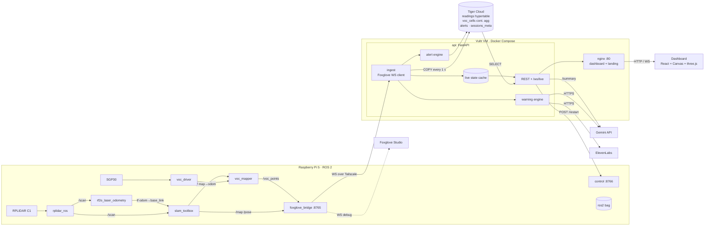

# Backend Architecture

Wearable LiDAR + VOC sensor → live floor plan with a gas heat map and the wearer's position.
The Pi is the only machine running ROS 2. Everything downstream is WebSocket / HTTP / SQL.

```
┌──────────────────────── Raspberry Pi 5 · Ubuntu 24.04 · ROS 2 Jazzy ────────────────────────┐
│                                                                                              │
│  RPLIDAR C1 ──USB──▶ rplidar_ros ──/scan──┬──▶ rf2o_laser_odometry ──tf odom→base_link──┐    │
│                                           │                                             ▼    │
│                                           └──────────────────────────────▶ slam_toolbox      │
│                                                                              │  /map         │
│                                                                              │  /pose        │
│  VOC (SGP30 TVOC ppb) ──I²C──▶ voc_driver ──/voc──▶ voc_mapper ──/voc_points │  tf map→odom  │
│                                               (tf lookup map→base_link       │               │
│                                                at t − sensor_lag)            │               │
│                                                                              ▼               │
│  static_transform_publisher ──/tf_static──▶ base_link→laser, base_link→voc_link              │
│                                                                                              │
│  ros2 bag record /scan /tf /tf_static /voc        (always on: demo replay fallback)          │
│                                                                                              │
│                         ┌──────────────────────────────────┐                                 │
│   all topics ──DDS──▶   │  foxglove_bridge   ws://pi:8765  │  ◀── only data exit from the Pi │
│                         └────────────────┬─────────────────┘                                 │
└──────────────────────────────────────────┼───────────────────────────────────────────────────┘
                                           │ Wi‑Fi · WebSocket
                   ┌───────────────────────┼─────────────────────────┐
                   │                       │                         │
                   ▼                       ▼                         ▼
          Foxglove Studio          FastAPI ingest on Vultr     (dashboard never
          (Mac, debug only)        (over Tailscale)             talks to the bridge)


┌───────────────────────── Vultr VM · 216.128.184.212 · Ubuntu · Docker Compose ───────────────┐
│                                                                                              │
│  ┌─────────────────────────── api: FastAPI (uvicorn :8000) ────────────────┐                 │
│  │                                                                         │                 │
│  │  ingest (asyncio task, Foxglove WS client, CDR decode)                  │                 │
│  │    subscribes /pose, /voc_points, /map, /voc                            │                 │
│  │    ├──▶ live state cache  {pose, voc, 60 s window, map PNG + meta}      │                 │
│  │    ├──▶ write buffer ──COPY every 1 s──▶ readings ──────────────────────┼──┐              │
│  │    ├──▶ alert engine     (> VOC_THRESHOLD for HOLD s, cooldown)         │  │              │
│  │    └──▶ warning engine   (> WARN_THRESHOLD: Gemini line + ElevenLabs)   │  │              │
│  │                                                                         │  │              │
│  │  WS  /ws/live     hello · pose @10 Hz · voc · sensor · map · alert …    │  │              │
│  │  GET /heatmap /trail /alerts /sessions /summary /map …   ◀── SQL ───────┼──┼──┐           │
│  │  POST /session/restart ──HTTP──▶ Pi control :8766 (restarts SLAM)       │  │  │           │
│  └─────────────────────────────────────────────────────────────────────────┘  │  │           │
│                                                                               │  │           │
│  ┌── nginx :80 ──┐  serves dashboard/dist (+ /landing/), /api/* → api:8000    │  │           │
│  └───────────────┘  /ws/* → api:8000/ws/* · plain HTTP, no TLS yet            │  │           │
│                                                                               │  │           │
│  timescaledb container: local fallback, unused with Tiger Cloud               │  │           │
└──────────────────────────────────────────┬────────────────────────────────────┼──┼───────────┘
                                           │ HTTP / WS                          │  │ TLS, Postgres
                                           ▼                                    ▼  ▼
                            ┌──────────────────────────────┐   ┌──────────────── Tiger Cloud (Tiger Data) ───────────┐
                            │  Dashboard (browser)         │   │  hypertable      readings (1-day chunks)            │
                            │  React · Canvas · three.js   │   │  cont. aggregate voc_cells (10 s × 20 cm cells)     │
                            │  gas model in a Web Worker   │   │  tables          alerts, sessions_meta (scans)      │
                            │  2D / 3D / first person      │   │  policies        refresh 10 s · compress after 1 h  │
                            └──────────────────────────────┘   └─────────────────────────────────────────────────────┘
```

## Mermaid version



## Components

### Pi (ROS 2 side)

| Node | Package | In | Out |
|---|---|---|---|
| `rplidar_ros` | apt | USB serial | `/scan` |
| `rf2o_laser_odometry` | source | `/scan` | tf `odom→base_link` |
| `slam_toolbox` | apt | `/scan`, tf | `/map`, `/pose`, tf `map→odom` |
| `voc_driver` | **ours** | I²C | `/voc` (`VocReading`: voc, unit, eco2, raw_h2, raw_ethanol, temp, humidity, warmed_up) |
| `voc_mapper` | **ours** | `/voc`, tf | `/voc_points` (`PointCloud2`: x, y, z, voc, t), new points only |
| `static_transform_publisher` | apt | – | `/tf_static` |
| `foxglove_bridge` | apt | all topics | WebSocket `:8765` |
| `ros2 bag record` | apt | topics | `.mcap` file for replay |

Launched together by one `mapping.launch.py` inside a tmux session that starts on boot.

### FastAPI (`api` container on the Vultr VM)

| Piece | Responsibility |
|---|---|
| **ingest** | Background `asyncio` task speaking the Foxglove WebSocket protocol (`app/foxglove.py`), decoding CDR with `mcap_ros2`. Subscribes to `/pose`, `/voc_points`, `/map`, `/voc`. The Pi sends only new `/voc_points`, each with its own timestamp; on startup ingest skips the Pi's backlog if the session already has rows. Tolerates 90 s stalls on the hotspot link before dropping the bridge. |
| **live state cache** | Latest pose, latest voc, 60 s window, latest `/map` rendered to PNG + origin/resolution. `/ws/live` reads only from here, so the DB is never on the hot path. |
| **write buffer** | Rows queue in memory (up to 50 000) and go to Tiger Cloud with `COPY` once per second. If the DB is unreachable they keep buffering and flush when it returns; DB-backed routes answer 503 meanwhile. |
| **alert engine** | Fires when `voc > VOC_THRESHOLD` for `VOC_HOLD_SECONDS`, respects `ALERT_COOLDOWN_SECONDS`. Writes a row to `alerts` (with the map PNG) and pushes an `alert` event. |
| **warning engine** | Above `WARN_THRESHOLD` (100 ppb) for a few seconds: Gemini writes one spoken line, ElevenLabs voices it (`/warnings/{id}/audio.mp3`), template text and the browser's voice are the fallbacks. |
| **summary** | `/summary`: top cells from `voc_cells` + heat PNG → Gemini → plain-English report, cached 60 s. |
| **sessions** | The current scan id survives API restarts. `POST /session/save` names a scan and stores its final map in `sessions_meta`; `POST /session/restart` saves it, asks the Pi's control server (`:8766`) to restart SLAM and the point buffer, and opens a new session. |

### Endpoints

Served at `/api/*` through nginx (prefix stripped), WebSocket at `/ws/live`.

| Method | Path | Source | Returns |
|---|---|---|---|
| WS | `/ws/live` | cache | `hello` on connect · `pose` @10 Hz · `voc` · `sensor` · `map` on change · `alert` · `warning` · `bridge` |
| GET | `/heatmap?session=&until=&half_life=` | `voc_cells` | `{cells: [{cx, cy, mean, weight, sd, n}]}`, decayed by bucket age (default half-life 180 s) |
| GET | `/trail?session=&since=&until=` | `readings` | `[{ts, x, y, heading, voc}]` |
| GET | `/map`, `/map/meta` | cache | occupancy PNG / its origin, resolution, size |
| GET | `/alerts`, `/alerts/{id}/map.png` | `alerts` | alert history / the map at alert time |
| GET | `/summary?force=` | `voc_cells` + Gemini | `{text, source: "gemini" \| "fallback"}` |
| GET | `/sessions`, `/sessions/{s}/map.png` | `readings` + `sessions_meta` | scan catalog / a saved scan's map |
| GET/POST | `/session`, `/session/save`, `/session/restart` | — | current scan · save it · start a new one |
| GET/POST | `/warnings`, `/warnings/{id}/audio.mp3`, `/warnings/test` | warning engine | spoken warnings |
| GET | `/health` | — | bridge, DB, session status |

### Tiger Data (Tiger Cloud)

The database is a **Tiger Cloud** service (managed Postgres + TimescaleDB), not the VM: the API reaches it over TLS via `DATABASE_URL`. [`db/schema.sql`](../db/schema.sql) is the source of truth; the parts that matter:

```sql
-- every VOC sample, already placed on the map by voc_mapper
CREATE TABLE readings (ts TIMESTAMPTZ NOT NULL, session TEXT NOT NULL,
                       x REAL NOT NULL, y REAL NOT NULL, heading REAL, voc REAL NOT NULL);
SELECT create_hypertable('readings', by_range('ts', INTERVAL '1 day'));

-- the heat map: 10 s buckets × 20 cm cells; materialized_only = false so the
-- newest rows (not yet refreshed) are included
CREATE MATERIALIZED VIEW voc_cells
WITH (timescaledb.continuous, timescaledb.materialized_only = false) AS
SELECT time_bucket('10 seconds', ts) AS bucket, session,
       floor(x / 0.2)::int AS cx, floor(y / 0.2)::int AS cy,
       avg(voc) AS mean, stddev(voc) AS sd, count(*) AS n
FROM readings GROUP BY bucket, session, cx, cy;

-- refresh every 10 s with no lower bound, so late rows (DB outage backlog, replays) still land
SELECT add_continuous_aggregate_policy('voc_cells', start_offset => NULL,
  end_offset => INTERVAL '10 seconds', schedule_interval => INTERVAL '10 seconds');

-- compress finished walks
ALTER TABLE readings SET (timescaledb.compress, timescaledb.compress_segmentby = 'session',
                          timescaledb.compress_orderby = 'ts DESC');
SELECT add_compression_policy('readings', INTERVAL '1 hour');

-- alerts keep the map at alert time; sessions_meta is the saved-scan catalog
CREATE TABLE alerts (id SERIAL PRIMARY KEY, ts TIMESTAMPTZ NOT NULL, session TEXT NOT NULL,
                     x REAL, y REAL, voc REAL, map_png BYTEA, map_origin_x REAL, map_origin_y REAL, map_res REAL);
CREATE TABLE sessions_meta (session TEXT PRIMARY KEY, name TEXT, notes TEXT, saved_at TIMESTAMPTZ,
                            map_png BYTEA, map_origin_x REAL, map_origin_y REAL, map_res REAL, map_w INT, map_h INT);
```

Apply it once to the Tiger Cloud service:

```bash
docker run --rm -i timescale/timescaledb:latest-pg16 psql "$DATABASE_URL" < db/schema.sql
```

Heat map query (decay weight by bucket age):

```sql
SELECT cx, cy,
       sum(mean * n * w) / sum(n * w) AS mean,
       sum(n * w)                     AS weight
FROM (
  SELECT *, power(0.5, extract(epoch FROM ($2::timestamptz - bucket)) / $3) AS w
  FROM voc_cells
  WHERE session = $1 AND bucket <= $2
) t
GROUP BY cx, cy;
```

### Deployment (Vultr)

One Vultr VM (`216.128.184.212`) runs `docker-compose.yml` from the repo root, checked out at `~/super-fire-project`:

```
docker-compose.yml
├── api           ./backend (uvicorn :8000)     env_file: backend/.env  (DATABASE_URL → Tiger Cloud, BRIDGE_URL → Pi)
├── nginx         ./deploy/nginx.conf           :80 (443 mapped, not configured) · serves ./dashboard/dist · /api → api:8000, /ws → api:8000
└── timescaledb   local fallback                only used if DATABASE_URL points at it instead of Tiger Cloud
```

Deploy from a Mac with `deploy/deploy.sh`:

```bash
./deploy/deploy.sh             # push the current branch, VM checks it out + rebuilds api, build + rsync dashboard
./deploy/deploy.sh api         # backend only
./deploy/deploy.sh dashboard   # dashboard only (~20 s): npm run build locally, rsync dist/ to the VM
```

The script ends by printing `/api/health` from the VM. The dashboard is built on the Mac, not the VM, and nginx serves it as static files. To develop the dashboard against the deployed backend: `BACKEND=http://216.128.184.212 npm run dev`.

**Pi ↔ VM.** The VM connects out to the Pi, so the Pi must be reachable: Tailscale on both, `BRIDGE_URL=ws://<pi-tailscale-ip>:8765`. The Pi's control server (`:8766`, derived from `BRIDGE_URL` unless `PI_CONTROL_URL` is set) handles scan restarts. The Pi rides a phone hotspot, so short drops are expected.

**TLS.** Not set up: the dashboard is plain HTTP on the VM's IP. `deploy/nginx.conf` already serves `/.well-known/acme-challenge/`; add a domain, run `certbot certonly --webroot`, and add an `ssl` server block.

### Replay mode

`ros2 bag play` on the Pi re-publishes recorded topics; the bridge and everything downstream can't tell the difference. For a Pi-free demo, run the ingest worker against a bag played from the Mac via a local `foxglove_bridge` inside the Ubuntu VM, or pick a saved scan from the catalog (served from Tiger Cloud) and drive the dashboard from `/heatmap?until=` with the scrubber.

### Environment

All API settings live in `backend/.env` on the VM (template: `backend/.env.example`, never committed).

| Var | Where | Example / default |
|---|---|---|
| `DATABASE_URL` | api | `postgres://tsdbadmin:…@<service>.tsdb.cloud.timescale.com:<port>/tsdb?sslmode=require` |
| `BRIDGE_URL` | api | `ws://<pi-tailscale-ip>:8765` |
| `PI_CONTROL_URL` | api | optional; default `http://<bridge host>:8766` |
| `GEMINI_API_KEY`, `GEMINI_MODEL` | api | –, `gemini-2.5-flash` |
| `ELEVENLABS_API_KEY`, `ELEVENLABS_VOICE_ID` | api | optional; browser voice otherwise |
| `VOC_UNIT` | api | `ppb` (SGP30) |
| `VOC_THRESHOLD`, `VOC_HOLD_SECONDS`, `ALERT_COOLDOWN_SECONDS` | api | `2200`, `5`, `60` |
| `WARN_THRESHOLD` | api | `100` |
| `HEATMAP_HALF_LIFE` | api | `180` s |
| `SENSOR_LAG_SECONDS` | voc_mapper (Pi) | `12` |


## Implementation notes (backend as built, Oct 17)

- Code lives in `backend/app/`; run/test instructions in `backend/README.md`.
- **Ingest speaks the Foxglove WebSocket protocol directly** (`app/foxglove.py`). `roslibpy` was dropped
  because it implements the rosbridge protocol, which `foxglove_bridge` does not serve. Jazzy's bridge
  negotiates `foxglove.sdk.v1`; ingest accepts that and `foxglove.websocket.v1`.
- `voc_cells` is created with `materialized_only = false` so `/heatmap` includes readings newer than
  the last 10 s refresh.
- `tools/fake_pi.py` is a Foxglove server that stands in for the Pi (walker + VOC source + spike).
